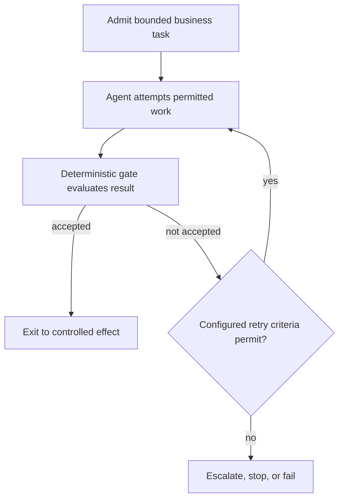

# Overview

The Bounded Convergence Loop governs iterative agent remediation tasks—such as dependency updates, lint corrections, or documentation fixes—where solutions require repeated attempts [^evt-wg-workflows-and-process-integration-file-dc0b08806fbd-14b411d8]. The pattern provides the benefits of iterative execution without permitting unbounded retries, open-ended objectives, or self-declared completion [^evt-wg-workflows-and-process-integration-file-dc0b08806fbd-14b411d8].

Every candidate iteration must be assessed by an independent [Deterministic Acceptance Gate](../patterns/deterministic-acceptance-gate.md) [^evt-wg-workflows-and-process-integration-file-dc0b08806fbd-14b411d8]. The pattern is used directly within the [Bounded Autonomous Remediation](../architectures/bounded-autonomous-remediation.md) reference architecture and interfaces with the [Proposal/Execution Split](../patterns/proposal-execution-split.md) and [Durable Wait](../patterns/durable-wait.md) patterns [^evt-wg-workflows-and-process-integration-file-dc0b08806fbd-14b411d8].

# Architecture / Specification

The workflow admits an explicitly defined task, restricts agent capabilities to the declared scope, and subjects every output to a deterministic gate [^evt-wg-workflows-and-process-integration-file-dc0b08806fbd-14b411d8]. If non-accepted, retries are evaluated against preconfigured constraints including maximum iteration counters, execution deadlines, and cost allocations [^evt-wg-workflows-and-process-integration-file-dc0b08806fbd-14b411d8].

### Invariants

- **Pre-execution constraints:** Task scope, tool access boundaries, and acceptance criteria must be declared before the loop initiates [^evt-wg-workflows-and-process-integration-file-dc0b08806fbd-14b411d8].
- **External evaluation:** The agent cannot certify its own completion; an external deterministic gate evaluates all candidate results [^evt-wg-workflows-and-process-integration-file-dc0b08806fbd-14b411d8].
- **Explicit budgets:** Each retry loop requires an explicit iteration cap and at least one time or token/monetary budget limit [^evt-wg-workflows-and-process-integration-file-dc0b08806fbd-14b411d8].
- **State persistence:** The workflow logs the attempt counter, gate verdicts, and termination reasons, resuming from recorded checkpoints rather than resetting budgets upon restart [^evt-wg-workflows-and-process-integration-file-dc0b08806fbd-14b411d8].
- **Fail-bounded:** Failed gates terminate strictly in bounded retries, escalations, human intervention, or recorded failure [^evt-wg-workflows-and-process-integration-file-dc0b08806fbd-14b411d8].
- **Scope enforcement:** Output passing technical checks but violating scope cannot proceed to side-effect execution [^evt-wg-workflows-and-process-integration-file-dc0b08806fbd-14b411d8].

[^evt-wg-workflows-and-process-integration-file-dc0b08806fbd-14b411d8]: https://github.com/aaif/wg-workflows-and-process-integration/blob/774d4e09283835b4b0b5062ad389dc8dc48752b9/workstreams/reference-architectures/patterns/bounded-convergence-loop.md
