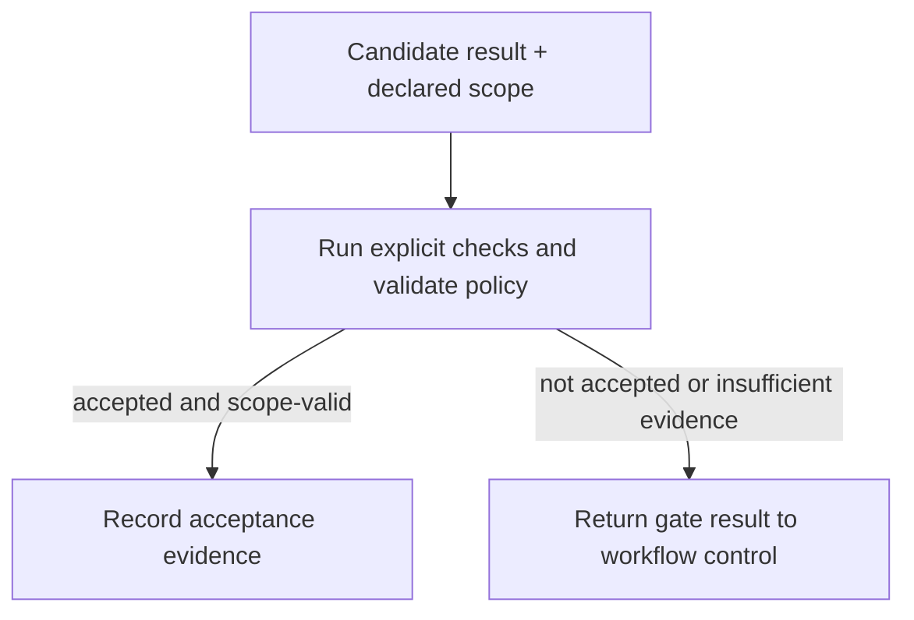

# Overview

A Deterministic Acceptance Gate evaluates candidate results using explicit, repeatable checks rather than relying on model self-assessment [^evt-wg-workflows-and-process-integration-file-970f1ea4eefc-4c010677]. In agent-assisted workflows, models that evaluate their own output are prone to confident but invalid self-certification [^evt-wg-workflows-and-process-integration-file-970f1ea4eefc-4c010677]. The gate validates candidates against pre-declared criteria—such as unit tests, schema validators, policy rules, and contract suites—alongside task scope constraints before granting workflow progression [^evt-wg-workflows-and-process-integration-file-970f1ea4eefc-4c010677].

Passing a deterministic gate serves as evidence that a declared acceptance condition was met, not as a general guarantee that the result is globally correct [^evt-wg-workflows-and-process-integration-file-970f1ea4eefc-4c010677]. The pattern is frequently paired with the [Bounded Convergence Loop](../patterns/bounded-convergence-loop.md), [Proposal/Execution Split](../patterns/proposal-execution-split.md), and [Bounded Autonomous Remediation](../architectures/bounded-autonomous-remediation.md) reference architecture [^evt-wg-workflows-and-process-integration-file-970f1ea4eefc-4c010677].

# Architecture / Specification

The candidate result and declared scope are submitted to the gate, which executes deterministic checks and validates policy rules [^evt-wg-workflows-and-process-integration-file-970f1ea4eefc-4c010677]. Scope validation checks target boundaries (systems, databases, or files), permitted change classes, data access permissions, allowed tool invocations, and external side effects [^evt-wg-workflows-and-process-integration-file-970f1ea4eefc-4c010677].

Control flow is decoupled from gate evaluation: the gate reports acceptance or non-acceptance with cryptographic or digest-bound evidence, while the enclosing workflow orchestrates downstream retries, escalations, or terminations [^evt-wg-workflows-and-process-integration-file-970f1ea4eefc-4c010677].

### Invariants

- **Pre-declared criteria:** Acceptance criteria must be declared prior to candidate evaluation [^evt-wg-workflows-and-process-integration-file-970f1ea4eefc-4c010677].
- **Independent evaluation:** The gate must run independently of the generative model or agent that produced the candidate result [^evt-wg-workflows-and-process-integration-file-970f1ea4eefc-4c010677].
- **Candidate digest binding:** Acceptance evidence must bind cryptographically or uniquely to the exact evaluated version or digest [^evt-wg-workflows-and-process-integration-file-970f1ea4eefc-4c010677].
- **Mandatory scope conjunction:** A result cannot pass if technical checks succeed but policy or scope checks fail [^evt-wg-workflows-and-process-integration-file-970f1ea4eefc-4c010677].
- **Fail-closed:** Ambiguous, unexecuted, or failing checks must default to non-acceptance [^evt-wg-workflows-and-process-integration-file-970f1ea4eefc-4c010677].
- **Auditability:** The workflow engine must log inputs, evaluation results, and control decisions [^evt-wg-workflows-and-process-integration-file-970f1ea4eefc-4c010677].
- **Authority limits:** Gate authority is strictly bounded to its declared contract; downstream effects require explicit authorization controls [^evt-wg-workflows-and-process-integration-file-970f1ea4eefc-4c010677].

[^evt-wg-workflows-and-process-integration-file-970f1ea4eefc-4c010677]: https://github.com/aaif/wg-workflows-and-process-integration/blob/774d4e09283835b4b0b5062ad389dc8dc48752b9/workstreams/reference-architectures/patterns/deterministic-acceptance-gate.md
